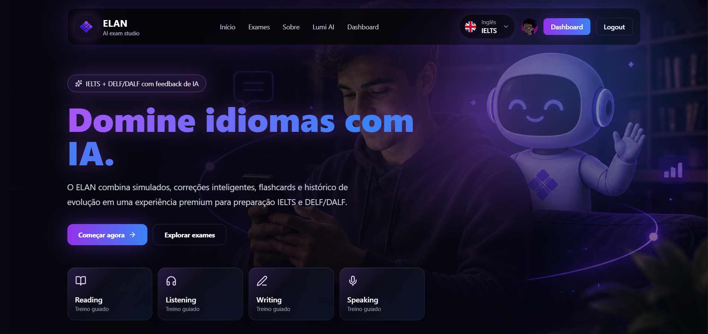
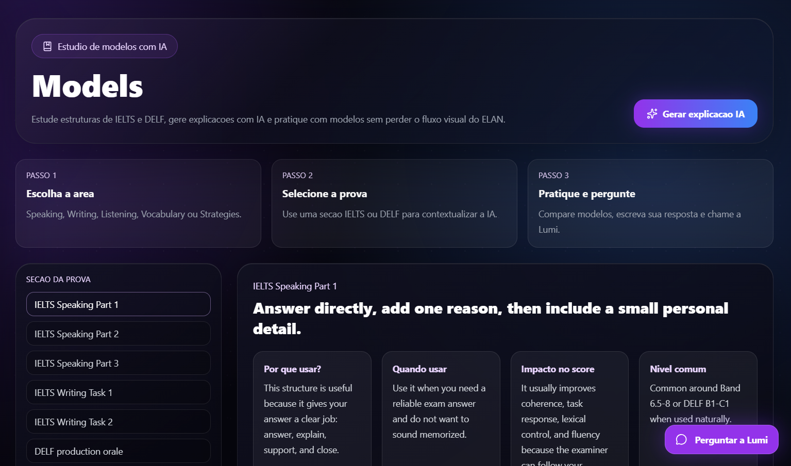

# ELAN

<p align="center">
  
</p>

<p align="center">
  Plataforma full stack de aprendizado de idiomas para IELTS e DELF/DALF, com estudos guiados, simulados, flashcards e recursos opcionais de Inteligencia Artificial.
</p>

<p align="center">
  
  
  
  
  
  
</p>

## Sobre o projeto

ELAN e uma plataforma criada para portfolio, focada em centralizar ferramentas de estudo para exames internacionais de idiomas.

O projeto inclui treino de reading, listening, writing, speaking, modelos de resposta, flashcards, historico de desempenho, estudos com YouTube e a assistente Lumi. As chamadas de IA passam sempre pelo backend para que chaves privadas nunca sejam expostas no navegador.

## Funcionalidades

- Preparacao IELTS e DELF/DALF.
- Simulados e treinos por habilidade.
- Correcao de writing e speaking com IA, quando configurada.
- Assistente de estudos Lumi.
- Geracao opcional de modelos e provas de reading via IA.
- Flashcards e anotacoes de estudo.
- Autenticacao com Firebase.
- Persistencia com MongoDB.

## Limitacoes da demonstracao publica

As funcionalidades de Inteligência Artificial dependem de uma chave de API própria. Por questões de segurança e custo, elas não estão disponíveis na demonstração pública. Consulte o README para saber como configurar.

Quando `AI_API_KEY` nao estiver configurada, o backend responde de forma controlada e a interface mostra uma mensagem amigavel. O restante da aplicacao continua funcionando.

## Tecnologias

Frontend:

- React
- Vite
- Tailwind CSS
- React Router
- Firebase Auth
- Recharts
- Axios

Backend:

- Node.js
- Express
- MongoDB
- Mongoose
- Firebase Admin SDK
- Axios
- dotenv
- Groq com endpoint OpenAI-compatible

## Estrutura

```text
.
├── backend/       API Express, modelos MongoDB, rotas e provider de IA
├── frontend/      Aplicacao React, paginas, componentes e servicos HTTP
├── docs/          Documentacao tecnica complementar
├── Assets/        Imagens usadas no README
└── docker-compose.yml
```

## Instalacao local

Clone o repositorio:

```bash
git clone https://github.com/NxcolasDev/Elanv2
cd Elanv2
```

Instale as dependencias:

```bash
cd backend
npm install

cd ../frontend
npm install
```

Suba um MongoDB local, se nao for usar MongoDB Atlas:

```bash
docker compose up -d
```

## Variaveis de ambiente

Crie arquivos locais a partir dos exemplos:

```bash
cp backend/.env.example backend/.env
cp frontend/.env.example frontend/.env
```

Backend (`backend/.env`):

| Variavel | Obrigatoria | Proposito |
| --- | --- | --- |
| `PORT` | Nao | Porta local da API Express. Em deploy, a plataforma geralmente injeta esse valor. |
| `MONGO_URI` | Sim | String de conexao com MongoDB local ou MongoDB Atlas. |
| `CORS_ORIGIN` | Sim | Lista de origens do frontend autorizadas a chamar a API. Separe multiplas URLs por virgula. |
| `NODE_ENV` | Sim | Use `development` localmente e `production` em deploy. |
| `AI_API_KEY` | Nao | Chave privada da Groq para recursos de IA. Se ficar vazia, a IA e desativada com mensagem amigavel. |

Frontend (`frontend/.env`):

| Variavel | Obrigatoria | Proposito |
| --- | --- | --- |
| `VITE_API_BASE_URL` | Sim | URL publica do backend. Localmente: `http://localhost:5000`. |
| `VITE_FIREBASE_API_KEY` | Sim | Chave publica do app web Firebase. |
| `VITE_FIREBASE_AUTH_DOMAIN` | Sim | Dominio de autenticacao Firebase. |
| `VITE_FIREBASE_PROJECT_ID` | Sim | ID do projeto Firebase. |
| `VITE_FIREBASE_STORAGE_BUCKET` | Sim | Bucket associado ao projeto Firebase. |
| `VITE_FIREBASE_MESSAGING_SENDER_ID` | Sim | Sender ID do Firebase. |
| `VITE_FIREBASE_APP_ID` | Sim | App ID do Firebase Web App. |

Importante: valores `VITE_*` ficam publicos no JavaScript do navegador. Nunca coloque segredos de backend no frontend.

## Execucao local

Backend:

```bash
cd backend
npm run dev
```

Frontend:

```bash
cd frontend
npm run dev
```

Acesse o frontend em `http://localhost:5173`.

## Build de producao

Frontend:

```bash
cd frontend
npm run build
npm run preview
```

Backend:

```bash
cd backend
npm start
```

## Deploy recomendado

Recomendacao para portfolio:

- Frontend na Vercel.
- Backend no Render ou Railway.
- Banco de dados no MongoDB Atlas.

Essa combinacao e simples para projetos full stack separados: a Vercel e excelente para Vite/React, enquanto Render/Railway executam o servidor Express de forma direta com variaveis privadas. MongoDB Atlas evita depender de um banco rodando na mesma maquina do deploy.

Configuracao de deploy:

Frontend:

- Root directory: `frontend`
- Build command: `npm run build`
- Output directory: `dist`
- Variaveis: todas as `VITE_*`
- `VITE_API_BASE_URL`: URL publica do backend

Backend:

- Root directory: `backend`
- Build command: `npm install`
- Start command: `npm start`
- Variaveis: `MONGO_URI`, `CORS_ORIGIN`, `NODE_ENV=production` e opcionalmente `AI_API_KEY`
- `CORS_ORIGIN`: URL publica do frontend

## Seguranca

- Nunca commite arquivos `.env`.
- Nunca commite chaves de API, tokens, senhas ou URLs privadas de banco.
- Os arquivos `.env.example` usam apenas valores ficticios e podem ser enviados ao GitHub.
- Se uma chave real for exposta, revogue ou rotacione no painel do provedor. Apagar o commit mais recente nao remove o segredo do historico.

## Screenshots

### Dashboard


### Flashcards


### Models



### YouTube Study


### Full Simulation


## Documentacao complementar

- `docs/TECHNICAL_DOCUMENTATION.md`
- `docs/ELECTRON_PREPARATION.md`

## Autor

Nicolas Silva
