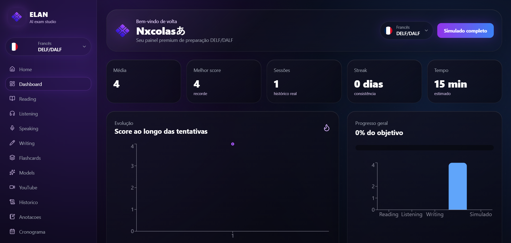
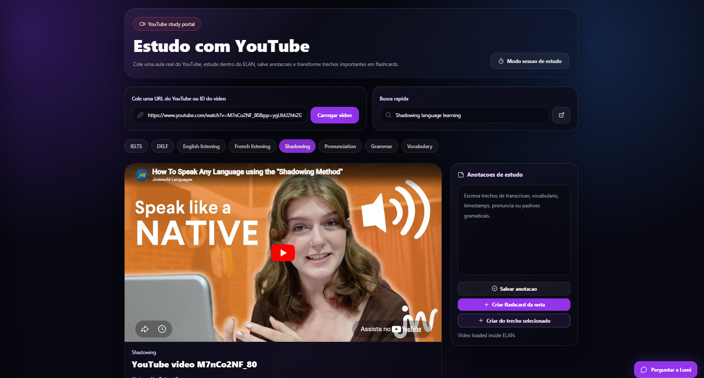
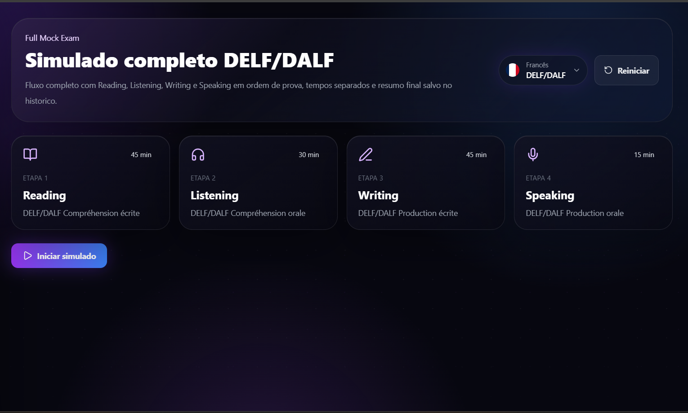

<p align="center">
  
</p>

<h1 align="center">ELAN</h1>

<p align="center">
AI-powered language learning platform focused on IELTS and DELF preparation.
</p>

---

# ELAN


---

# Overview

ELAN is a full-stack language learning platform designed to centralize advanced study tools for international language exams.

The platform combines:
- AI-assisted learning
- Flashcards
- Writing practice
- Speaking preparation
- Reading and listening exercises
- Full exam simulations
- YouTube study workflows
- Vocabulary analysis

Originally built as a personal learning platform, ELAN evolved into a complete study ecosystem focused on productivity and immersive language practice.

---

# Features

## IELTS & DELF Preparation
- Reading practice
- Listening exercises
- Writing generation
- Speaking prompts
- Full mock simulations
- Study models and structures

## AI Features
- AI-assisted explanations
- Vocabulary guidance
- Writing feedback
- Study assistant (Lumi)

## Flashcard System
- Deck organization
- Spaced repetition structure
- Add cards directly from study sessions
- Persistent local storage

## YouTube Study Mode
- Embedded study videos
- Study notes
- Flashcard integration
- AI contextual assistant

## News Study Mode
- BBC integration
- TV5MONDE integration
- Vocabulary-focused workflow

---

# Screenshots

## Dashboard



---

## Flashcards


---

## Models


---

## YouTube Study



---

## Full Simulation



---

# Tech Stack

## Frontend
- React
- Vite
- TailwindCSS
- React Router

## Backend
- Node.js
- Express
- MongoDB
- Mongoose

## AI Integration
- Groq API
- OpenAI-compatible architecture

---

# Project Structure

```bash
frontend/
backend/
docs/
assets/
README.md
docker-compose.yml
```

---

# Installation

## Clone repository

```bash
git clone YOUR_REPOSITORY_URL
```

---

## Backend setup

```bash
cd backend
npm install
npm run dev
```

---

## Frontend setup

```bash
cd frontend
npm install
npm run dev
```

---

# Environment Variables

## Backend

Create a `.env` file:

```env
PORT=5000
MONGO_URI=
CORS_ORIGIN=http://localhost:5173
NODE_ENV=development
AI_API_KEY=
```

---

## Frontend

Create a `.env` file:

```env
VITE_API_BASE_URL=http://localhost:5000
```

---

# Future Improvements

- Electron desktop version
- Mobile version
- Better spaced repetition algorithm
- AI pronunciation feedback
- Real-time speaking evaluation
- Lazy loading optimization

---

# Project Status

ELAN is currently in version 1.0.

All core systems are functional and operational, including:
- Flashcards
- AI study tools
- YouTube study mode
- IELTS/DELF simulations
- Writing and speaking practice

Some polishing, UI refinements, and additional improvements are still planned for future versions.

This version represents the first stable public release of the project.

# Documentation

Technical documentation and Electron preparation files are available inside the `/docs` folder.

---

# Author

Nicolas Silva

Built as a personal project focused on:
- language learning
- productivity
- AI-assisted education
- full-stack software engineering practice
