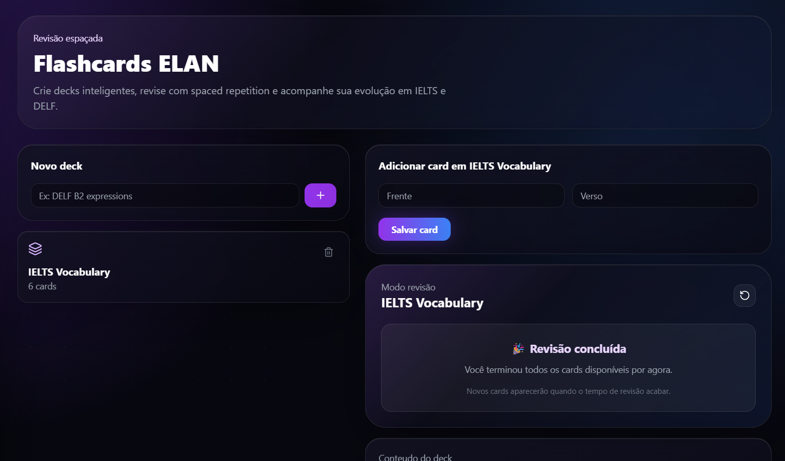

# ELAN

<p align="center">
  
</p>

<p align="center">
AI-powered language learning platform focused on IELTS and DELF/DALF preparation.
</p>

<p align="center">
  
  
  
  
  
  
</p>

## Overview

ELAN is a full-stack language learning platform designed to centralize advanced study tools for international language exams.

The platform combines AI-assisted learning, flashcards, writing practice, speaking preparation, reading and listening exercises, full exam simulations, YouTube study workflows, and vocabulary analysis.

The browser never calls the AI provider directly. All AI requests go through the backend so provider keys stay out of frontend code.

## Features

## IELTS & DELF Preparation

- Reading practice
- Listening exercises
- Writing generation
- Speaking prompts
- Full mock simulations
- Study models and structures

## AI Features

- AI-assisted explanations
- Vocabulary guidance
- Writing feedback
- Study assistant, Lumi
- OpenAI-compatible Groq provider through the backend

## Flashcard System

- Deck organization
- Spaced repetition structure
- Add cards directly from study sessions
- Persistent local storage

## YouTube Study Mode

- Embedded study videos
- Study notes
- Flashcard integration
- AI contextual assistant

## News Study Mode

- BBC integration
- TV5MONDE integration
- Vocabulary-focused workflow

## Screenshots

## Dashboard


## Flashcards



## Models


## YouTube Study


## Full Simulation


## Tech Stack

## Frontend

- React
- Vite
- Tailwind CSS
- React Router
- Firebase Auth

## Backend

- Node.js
- Express
- MongoDB
- Mongoose
- Axios
- dotenv

## Project Structure

```text
backend/     Express API, MongoDB models, AI provider, auth middleware
frontend/    React app, study pages, Firebase client config
docs/        Technical notes and future Electron preparation
Assets/      README images and project screenshots
```

## Installation

Clone the repository:

```bash
git clone https://github.com/NxcolasDev/Elanv2
cd Elanv2
```

Install dependencies:

```bash
cd backend
npm install

cd ../frontend
npm install
```

## Environment Setup

Copy the example files and create your own local `.env` files:

```bash
cp backend/.env.example backend/.env
cp frontend/.env.example frontend/.env
```

Fill `backend/.env` with your own private values:

```env
PORT=5000
MONGO_URI=your_mongodb_connection_string
CORS_ORIGIN=http://localhost:5173
NODE_ENV=development
AI_API_KEY=your_groq_api_key
```

Fill `frontend/.env` with your Firebase web app values:

```env
VITE_API_BASE_URL=http://localhost:5000
VITE_FIREBASE_API_KEY=your_firebase_web_api_key
VITE_FIREBASE_AUTH_DOMAIN=your_firebase_auth_domain
VITE_FIREBASE_PROJECT_ID=your_firebase_project_id
VITE_FIREBASE_STORAGE_BUCKET=your_firebase_storage_bucket
VITE_FIREBASE_MESSAGING_SENDER_ID=your_firebase_sender_id
VITE_FIREBASE_APP_ID=your_firebase_app_id
```

`AI_API_KEY` must be your own Groq API key. Do not reuse a key that was committed or exposed anywhere.

## Security Rules

Never commit real `.env` files, API keys, database URLs, passwords, tokens, service account files, or private credentials. Only `.env.example` files should be committed.

The backend `.env` is private because it contains `MONGO_URI` and `AI_API_KEY`. The frontend `VITE_*` values are public at runtime because they are bundled into browser JavaScript, so never put backend secrets there.

If a real key was ever pushed to GitHub, rotate or revoke it in the provider dashboard. Removing it from the latest commit is not enough because the old value may still exist in Git history.

## Development

Start MongoDB however you prefer. This repo includes Docker Compose for local database services:

```bash
docker compose up -d
```

Start the backend:

```bash
cd backend
npm run dev
```

Start the frontend:

```bash
cd frontend
npm run dev
```

The frontend expects the backend URL from `VITE_API_BASE_URL`. In local development, keep it pointed at the backend port configured in `backend/.env`.

## Git Hygiene

The repository ignores local environment files, dependency folders, and build output:

- `.env` files stay local.
- `.env.example` files are committed as safe templates.
- `node_modules/` is ignored.
- `dist/` and `build/` are ignored.

Before pushing, check:

```bash
git status
git diff --cached
```

## Project Status

ELAN is currently in version 1.0. Core systems are functional and operational, including flashcards, AI study tools, YouTube study mode, IELTS/DELF simulations, and writing and speaking practice.

## Documentation

More details are available in:

- `docs/TECHNICAL_DOCUMENTATION.md`
- `docs/ELECTRON_PREPARATION.md`

## Author

Nicolas Silva
