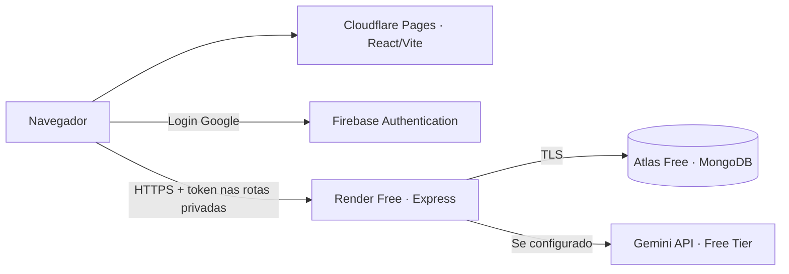

# Deploy gratuito do ÉLAN

Esta configuração publica uma demonstração de portfólio em subdomínios gratuitos. Use Cloudflare Pages para o frontend, Render Free para a API Express, Atlas Free para MongoDB e Firebase Spark para login Google. O Gemini é opcional. No Render, mantenha a conta sem forma de pagamento para que o excesso de cota resulte em suspensão. Para ativar a IA, use um projeto Gemini no Free Tier, sem billing habilitado, e confirme a disponibilidade do modelo na sua conta. [Render Free](https://render.com/docs/free) · [Firebase Spark](https://firebase.google.com/docs/projects/billing/firebase-pricing-plans) · [Billing do Gemini](https://aistudio.google.com/docs/billing)

## 1. Crie o Atlas Free e o serviço Render

1. No Atlas, crie um cluster **Free** (M0) em uma região próxima do Render. Em **Database Access**, crie um usuário próprio do app com permissão de leitura e escrita apenas no banco `elan`. Copie a URI do driver Node.js, preencha a senha com percent-encoding se necessário e inclua `/elan` antes dos parâmetros da URI.
2. No Render, crie um **Web Service** conectado ao repositório, branch `master`, runtime **Docker**, instância **Free** e Root Directory `backend`. O Dockerfile fica em `./Dockerfile`, relativo à Root Directory. Mantenha a implantação automática desabilitada durante a configuração e use `/api/ready` como Health Check Path. O serviço fornece a variável `PORT`.
3. No serviço, abra **Connect → Outbound** e autorize no **Network Access** do Atlas as faixas de saída informadas para aquele serviço. Essas faixas são compartilhadas. Mantenha a lista de acesso restrita às faixas necessárias e use TLS e credenciais exclusivas do banco. Caso o primeiro deploy rode antes disso, conclua a lista e faça um novo deploy manual. [Atlas Free](https://www.mongodb.com/docs/atlas/tutorial/deploy-free-tier-cluster/) · [Web Services](https://render.com/docs/web-services) · [IPs de saída do Render](https://render.com/docs/outbound-ip-addresses)

No Render, configure os valores abaixo em **Environment**. Substitua os domínios de exemplo pelos seus. O domínio de Pages pode ser ajustado após criar o projeto.

| Variável | Valor |
| --- | --- |
| `NODE_ENV` | `production` |
| `MONGO_URI` | URI privada do Atlas |
| `FIREBASE_PROJECT_ID` | ID do mesmo projeto Firebase usado no frontend |
| `CORS_ORIGIN` | Origem exata do frontend, como `https://elan-demo.pages.dev`, sem barra final |
| `GEMINI_API_KEY` | Vazia no primeiro deploy. Ative conforme a seção 4. |
| `AI_CONCURRENCY` | `1` para a demonstração |
| `AI_DAILY_ATTEMPTS` | `10` como limite inicial por processo |

Faça o deploy manual. Ao terminar, abra `https://SEU-API.onrender.com/api/ready` e confirme HTTP 200. A suspensão por inatividade é esperada no plano Free. Se a primeira abertura da interface atingir timeout enquanto a API acorda, abra o endpoint de prontidão e tente a operação novamente. O plano tem 750 horas gratuitas por workspace por mês e limites de uso compartilhados. [Limites do Render Free](https://render.com/docs/free)

## 2. Publique o frontend no Cloudflare Pages

1. Em **Workers & Pages**, crie um projeto **Pages** pelo Git. Selecione o repositório e `master` como branch de produção. Use a Root Directory `frontend`, Build Command `npm run build` e Build Output Directory `dist`.
2. Defina `NODE_VERSION=24` e `VITE_API_BASE_URL=https://SEU-API.onrender.com`. Copie para o ambiente de produção os campos **públicos** `VITE_FIREBASE_*` de [frontend/.env.example](../frontend/.env.example), com os valores do Firebase. Qualquer variável `VITE_*` entra no bundle. Guarde a chave Gemini, a URI Atlas e as credenciais administrativas apenas no backend.
3. Use o subdomínio `*.pages.dev` fornecido pelo serviço. Atualize `CORS_ORIGIN` no Render com essa origem e faça o deploy manual novamente se tiver alterado a variável. O Cloudflare Pages trata as rotas SPA como `/login` e `/admin` automaticamente quando o build não inclui um `404.html` de topo. [Build do Pages](https://developers.cloudflare.com/pages/configuration/build-configuration/) · [Versão do Node](https://developers.cloudflare.com/pages/configuration/build-image/) · [Rotas SPA](https://developers.cloudflare.com/pages/configuration/serving-pages/)

## 3. Ative e teste o Firebase

1. No Firebase Spark, abra **Authentication → Sign-in method** e habilite **Google**. Em **Authorized domains**, inclua o hostname do Pages, como `elan-demo.pages.dev`. Para o teste local, use `http://localhost:5173` se `localhost` estiver na lista. Mantenha em `VITE_FIREBASE_AUTH_DOMAIN` o domínio de autenticação retornado pela configuração do app web no Firebase. [Login Google no Firebase](https://firebase.google.com/docs/auth/web/google-signin)
2. Abra o site em uma janela anônima, faça login, visite o Dashboard e verifique o carregamento do perfil. Um usuário comum autenticado deve receber HTTP 403 em `/api/admin/status`. Uma sessão ausente ou inválida deve receber 401.
3. Para habilitar **admin**, o backend também precisa de ADC para verificar revogação. Crie uma conta de serviço dedicada com papel **Firebase Authentication Viewer** (`roles/firebaseauth.viewer`). Se a política do projeto permitir chaves, carregue o JSON como **Secret File** no Render com nome `firebase-runtime.json` e defina `GOOGLE_APPLICATION_CREDENTIALS=/etc/secrets/firebase-runtime.json`. O operador que concede papéis usa credenciais separadas com permissão de escrita, conforme o [guia do administrador](ADMIN_SYSTEM.md). Se o projeto não permitir emissão de chaves, mantenha a administração desabilitada até configurar uma identidade compatível com ADC. [Firebase Admin ADC](https://firebase.google.com/docs/admin/setup/) · [Papéis Firebase](https://firebase.google.com/docs/projects/iam/roles-predefined-product) · [Secret Files do Render](https://render.com/docs/configure-environment-variables)

## 4. Ative o Gemini opcionalmente

Entre no Google AI Studio e confirme que o **projeto da chave** está no **Free Tier**, com billing desabilitado e cota para o modelo escolhido. Um ponto de partida é `GEMINI_MODEL=gemini-3.1-flash-lite` se ele estiver disponível com cota gratuita no seu projeto. Defina `GEMINI_API_KEY` apenas no Render. Faça um teste curto na Lumi com texto fictício. Observe os limites do provedor e as regras de uso de dados do nível gratuito. `AI_DAILY_ATTEMPTS` é um limite local por processo que reinicia com o serviço e não controla faturamento. Se a cota acabar, use o material local ou deixe a chave vazia. [Preços por modelo](https://aistudio.google.com/docs/pricing) · [Limites Gemini](https://aistudio.google.com/docs/rate-limits) · [Termos Gemini](https://aistudio.google.com/docs/terms)

## 5. Verifique antes de compartilhar

- Abra o site, recarregue `/login` diretamente e confira leitura, exercícios locais e simulado.
- Com uma conta de teste, confirme o login, o perfil e a negativa de acesso administrativo. Se configurou admin, faça login novamente após conceder o papel e verifique uma prévia antes de publicar conteúdo.
- Confira as páginas de uso de Render, Pages, Atlas e AI Studio. Use as opções **Free/Spark** e os subdomínios incluídos. Aceite indisponibilidade ou espera quando atingir cotas. [Limites Pages](https://developers.cloudflare.com/pages/platform/limits/) · [Limites Atlas Free](https://www.mongodb.com/docs/atlas/reference/free-shared-limitations/)
- Mantenha o [workflow de Cloud Run](../.github/workflows/gcp-release.yml) desabilitado neste caminho. O [guia GCP](GCP_DEPLOYMENT_GUIDE.md) descreve outra topologia de infraestrutura.
