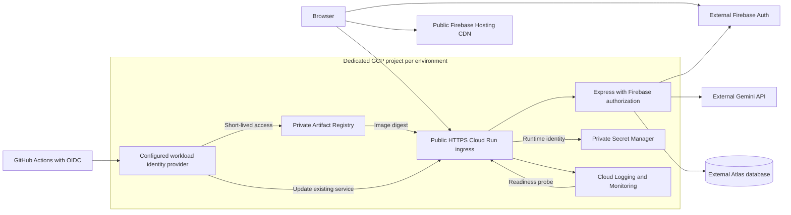

# Proposed GCP architecture

Firebase Hosting provides the CDN, HTTPS and SPA rewrite with less configuration than a Storage bucket, external load balancer, and Cloud CDN. Cloud Run scales from zero and keeps the API stateless. A small instance cap, MongoDB pool cap, and provider quotas constrain usage. Choose a region close to Atlas and learners. One region is sufficient for the portfolio rollout. Production availability still depends on the selected Atlas topology and configured alerting. [Deployment guide](../GCP_DEPLOYMENT_GUIDE.md)
