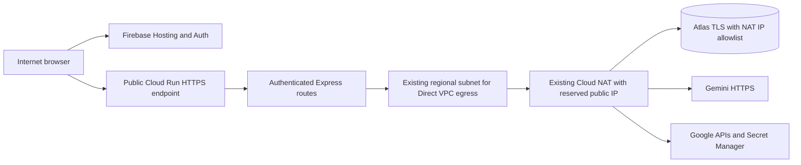

# Network topology

The VPC egress requirement gives Atlas a stable source IP. Terraform consumes an existing subnet and network. Cloud Run receives browser traffic on its managed HTTPS ingress. Firebase roles gate private application routes. The runtime identity grants Google API access. An Atlas private endpoint is an alternative if the Atlas tier, DNS and VPC networking justify it. Local Compose uses its own bridge network and binds MongoDB and Mongo Express to loopback. [Cloud Run static outbound IP](https://cloud.google.com/run/docs/configuring/static-outbound-ip) · [Atlas access list](https://www.mongodb.com/docs/atlas/security/ip-access-list/)
