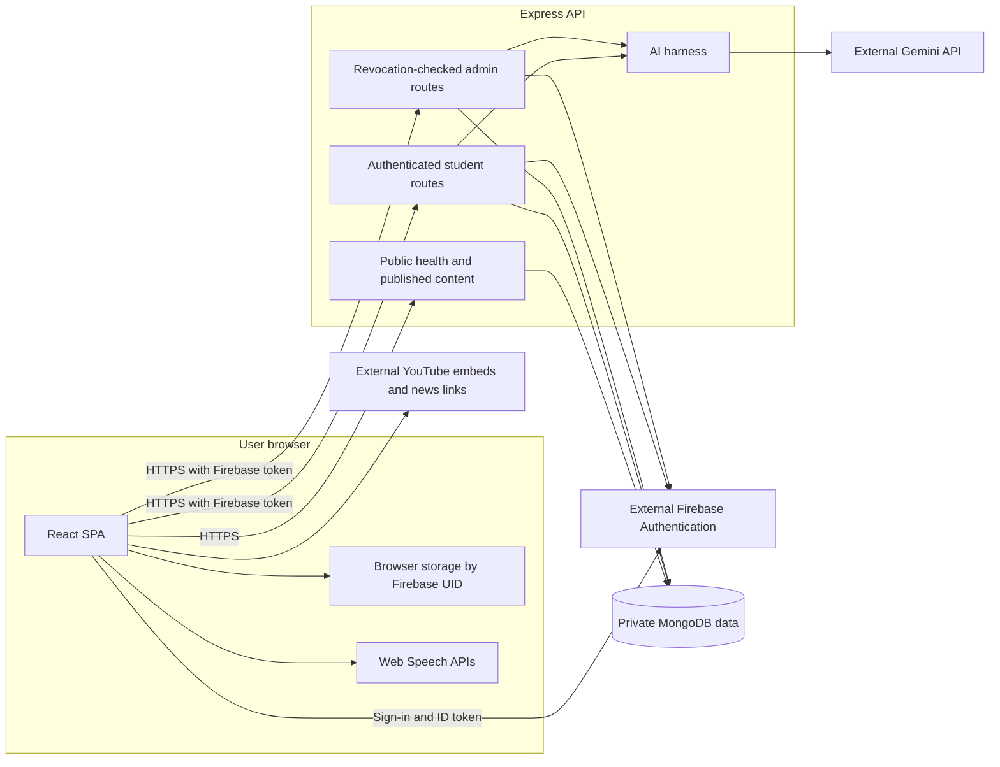

# System architecture

Reading, Listening, and Models consume published content with bundled material available as a fallback. The simulation and its scoring run in the browser. [Data ownership and flow](../TECHNICAL_DOCUMENTATION.md)
